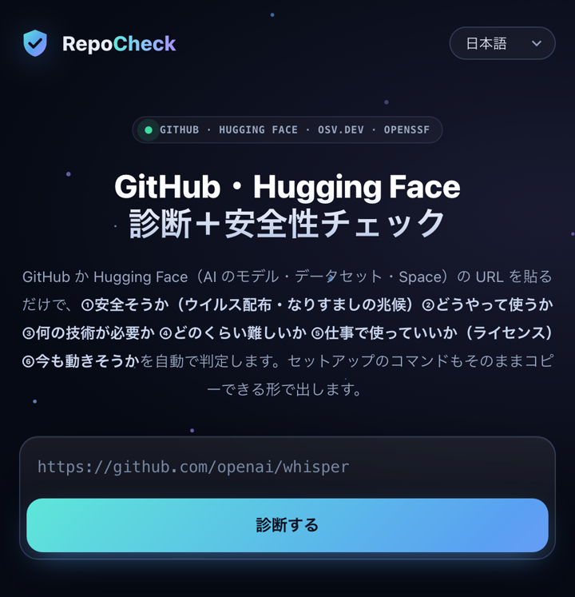
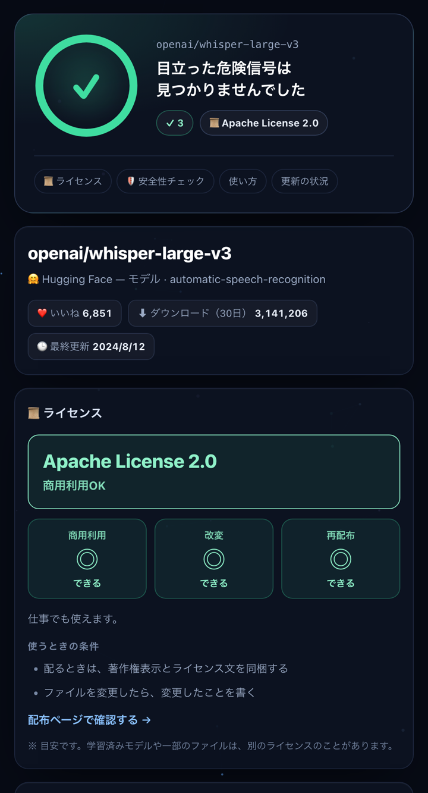

# RepoCheck

GitHub や Hugging Face の URL を貼るだけで、**入れる前に確かめたいこと**をまとめて判定する無料ツールです。

**▶ https://repocheck.youmix.info/** （登録不要・スマホでも使えます）

[](https://repocheck.youmix.info/?url=https%3A%2F%2Fgithub.com%2Fyoyo553%2FRepoCheck)



## 分かること

- **安全性**：ウイルス配布やなりすましの兆候、インストール時に動く処理、依存ライブラリの既知の脆弱性
- **ライセンス**：商用利用・改変・再配布ができるか（◎ △ × ？）と、使うときの条件
- **使い方**：おすすめの順の手順と、コピーできるコマンド
- **必要な技術と難易度**、今も動きそうか、つまずきやすい点



判定は、公開されている情報から危険の兆候を探す**目安**です。安全を保証するものではありません。

## 仕組み

- 画面も判定も `index.html` 1枚です（中国語・韓国語の訳は `i18n.js`）。ビルドは要りません。
- あなたのブラウザから GitHub・Hugging Face・OSV.dev・OpenSSF Scorecard の公開 API に直接問い合わせます。**調べた URL はサイトの運営者に送られません。**
- 日本語・English・简体中文・繁體中文・한국어 に対応しています。
- Mac アプリ版は `mac/` と `アプリを作り直す.command` で作れます。

## 手元で動かす

このリポジトリをダウンロードして、`index.html` をブラウザで開くだけです。

GitHub への問い合わせは、トークン無しだと1時間に60回（診断およそ7回分）までです。

## テスト

```bash
node tests/unit.mjs        # 部品テスト（通信なし）
node tests/harness.mjs     # 実在の公開リポジトリで誤報が無いかを確認（通信あり）
```

## フォルダ

| 場所 | 中身 |
|---|---|
| `index.html` | 本体（画面と判定） |
| `i18n/` | 訳の元データ（`python3 i18n/build.py` で `i18n.js` を作る） |
| `pages/` | よく調べられるツールの診断ページを作る |
| `web/` | 公開サイト用のファイル |
| `tests/` | テストと検証用の一覧 |
| `mac/` | Mac アプリ版 |

## 利用条件

ライセンスは付けていません（著作権は作者が持っています）。GitHub の利用規約で認められている閲覧と Fork を除き、利用・改変・再配布には作者の許可が必要です。

## 作者

[YOUMIX](https://youmix.info/)

---

**English**: RepoCheck checks a GitHub or Hugging Face URL for signs of malware or impersonation, license terms, setup steps and maintenance status. Try it at https://repocheck.youmix.info/?lang=en . Results are a rough guide, not a safety guarantee. No license is granted; all rights reserved.
